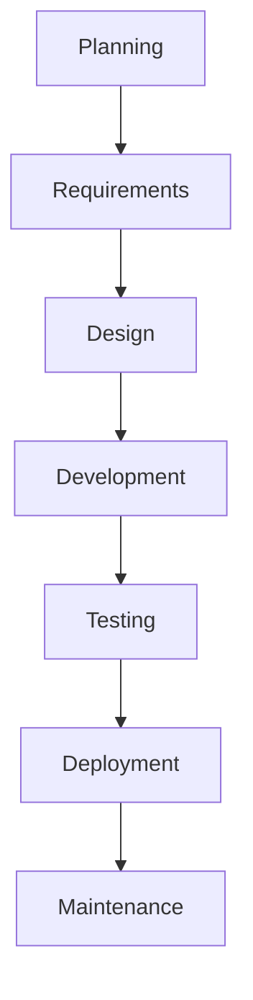
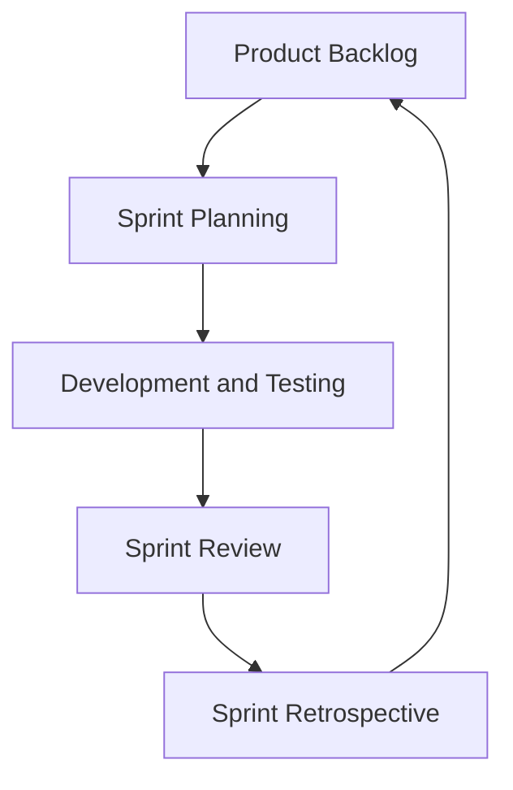

# SDLC – Software Development Life Cycle

## 1. What is SDLC?

SDLC is a structured process used to develop, test, deploy, and maintain software applications. It helps teams build quality software within the planned time and budget.

## 2. Phases of SDLC

1. **Planning:** Define project goals, scope, budget, and timeline.
2. **Requirement Analysis:** Understand functional and non-functional requirements.
3. **Design:** Design application architecture, database, APIs, and UI.
4. **Development:** Write code and implement application features.
5. **Testing:** Identify bugs and verify that the application works correctly.
6. **Deployment:** Release the application to users.
7. **Maintenance:** Fix bugs, improve performance, and add new features.

### SDLC Workflow

## 3. Common SDLC Models

### Waterfall Model

- Sequential development approach.
- Each phase is generally completed before the next begins.
- Suitable for projects with fixed requirements.
- Changes are difficult and costly after a phase is completed.

**Example:** Projects with clearly defined requirements.

### Agile Model

- Iterative and incremental development approach.
- Work is divided into smaller iterations.
- Supports changing requirements.
- Encourages continuous feedback and frequent delivery.

**Example:** E-commerce applications where features evolve over time.

### Other Models

- **Spiral:** Focuses on risk analysis and iterative development.
- **V-Model:** Connects development phases with corresponding testing phases.

## 4. Waterfall vs Agile

| Waterfall | Agile |
|---|---|
| Sequential approach | Iterative approach |
| Fixed requirements | Flexible requirements |
| Testing usually happens after development | Testing happens throughout iterations |
| Changes are difficult | Changes are easier |
| Delivery usually happens at the end | Frequent delivery |

**Conclusion:** Waterfall is suitable for stable requirements, whereas Agile is useful when requirements change frequently.

## 5. Agile and Scrum

**Agile:** A software development approach that focuses on collaboration, customer feedback, and continuous improvement.

**Scrum:** An Agile framework that organizes work into short development cycles called Sprints.

### Scrum Roles
- **Product Owner:** Manages and prioritizes product requirements.
- **Scrum Master:** Helps the team follow Scrum practices and removes obstacles.
- **Developers:** Build and test the product.

### Scrum Events
- **Sprint Planning:** Decide the work for the sprint.
- **Daily Scrum:** Short daily progress discussion.
- **Sprint Review:** Review completed work.
- **Sprint Retrospective:** Identify improvements for the next sprint.

### Scrum Workflow

## 6. Real-World Example

Consider a Task Management Application:

1. Planning: Define project goals.
2. Requirements: Users should create, update, and delete tasks.
3. Design: Prepare UI and database design.
4. Development: Build the application using Java and Spring Boot.
5. Testing: Test all task operations.
6. Deployment: Release the application.
7. Maintenance: Fix bugs and add improvements.

## 7. Key Terms

| Term | Meaning |
|---|---|
| SDLC | Software Development Life Cycle |
| SRS | Software Requirements Specification |
| Functional Requirements | What the application should do |
| Non-Functional Requirements | How the application should perform |
| User Story | Feature described from the user's perspective |
| Sprint | Fixed development period in Scrum |
| Deployment | Releasing software |
| Maintenance | Fixing and improving software |

## Conclusion

SDLC provides a structured approach to software development. Waterfall, Agile, Spiral, and V-Model are common SDLC models. Agile and Scrum are widely used to support collaboration, continuous feedback, and incremental delivery.