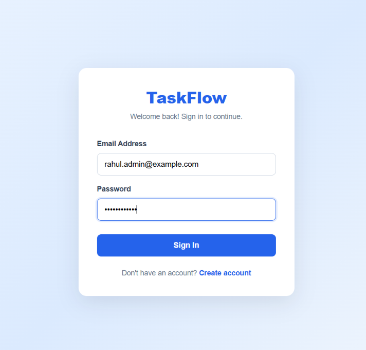
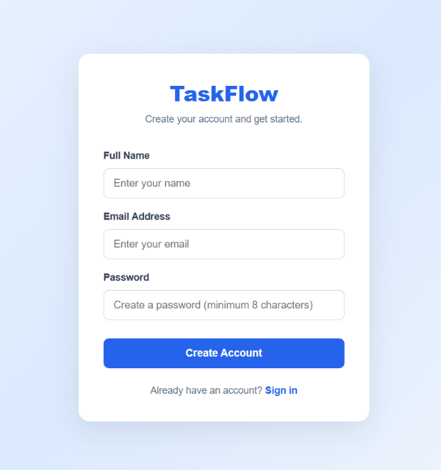
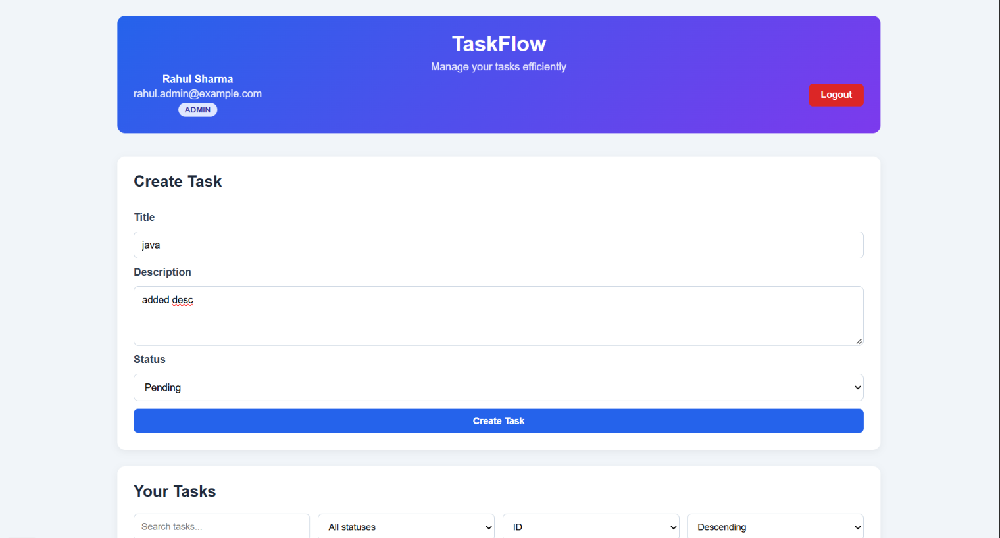
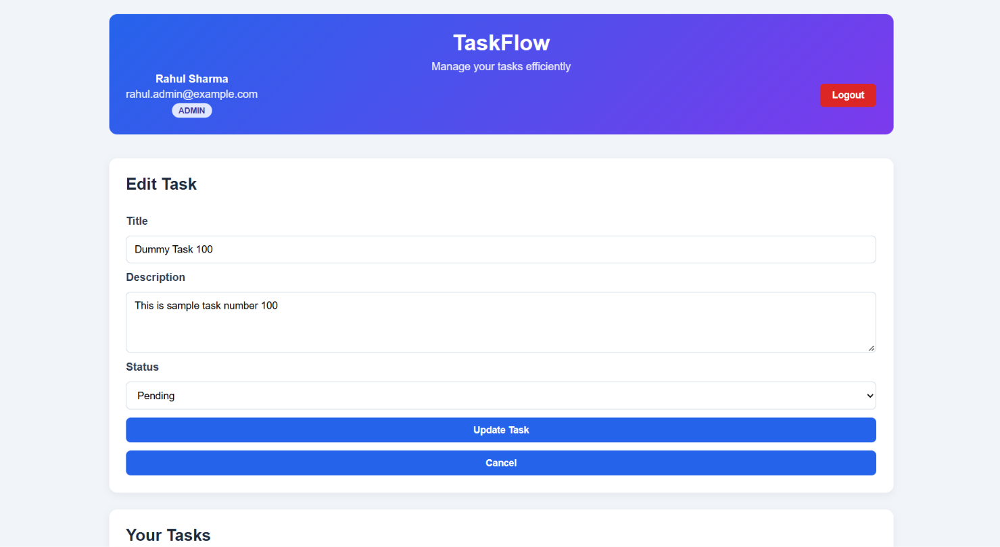
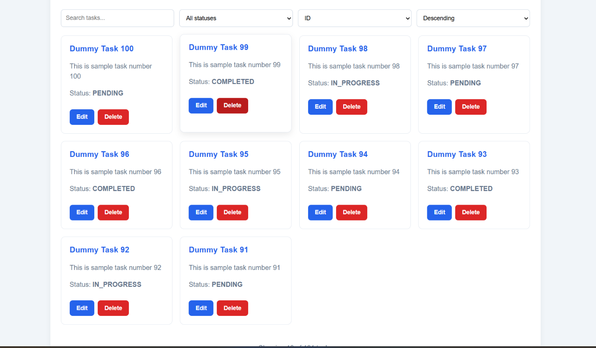

# Task Management Application

## 1. Project Overview

The Task Management Application is a full-stack web application that allows users to register, log in, and manage their tasks.

Users can create, view, update, delete, and track tasks based on their status.

The application is built using React, TypeScript, Node.js, Express, and PostgreSQL.

## 2. Features

- User registration and login with JWT authentication.
- Create, view, update, and delete tasks.
- Task status management.
- Input validation using Zod.
- REST API architecture.
- Centralized error handling.
- API documentation using Swagger.
- Rate limiting for login requests.
- Responsive frontend interface.
- Docker-based application deployment.
- Automated testing and CI using GitHub Actions.

## 3. Technologies Used

| Layer | Technologies |
|---|---|
| Frontend | React, TypeScript, HTML, CSS |
| Frontend Build Tool | Vite |
| Backend | Node.js, Express, TypeScript |
| Database | PostgreSQL |
| Authentication | JWT |
| Validation | Zod |
| Testing | Vitest |
| API Documentation | Swagger |
| Containerization | Docker, Docker Compose |
| Web Server | Nginx |
| CI | GitHub Actions |

## 4. System Architecture

```text
             User / Browser
                    |
                    v
             React Frontend
              (Port 8080)
                    |
                    v
                  Nginx
             Reverse Proxy
                    |
                    v
             Express REST API
              (Port 3000)
                    |
          ---------------------
          |         |         |
          v         v         v
       Routes   Middleware  Services
                              |
                              v
                         Repositories
                              |
                              v
                         PostgreSQL
                         (Port 5434)
```

## 5. Project Structure

```text
Project/
│
├── backend/
│   └── task-crud-api integrating postgres/
│       ├── src/
│       ├── tests/
│       ├── database/
│       ├── Dockerfile
│       ├── package.json
│       └── tsconfig.json
│
├── frontend/
│   └── task-ui/
│       ├── src/
│       ├── public/
│       ├── Dockerfile
│       ├── nginx.conf
│       ├── package.json
│       └── vite.config.ts
│
├── docker-compose.yml
└── README.md
```

## 6. Prerequisites

To run the application locally, install:

- Node.js 22 or later
- npm
- PostgreSQL 17
- Docker Desktop (for containerized execution)
- Git

## 7. Running the Application with Docker

Clone the repository and navigate to the Project directory.

```bash
cd Project
```

Build and start all services:

```bash
docker compose up --build
```

The application starts the following services:

| Service | URL / Port |
|---|---|
| Frontend | http://localhost:8080 |
| Backend API | http://localhost:3000 |
| PostgreSQL | localhost:5434 |

To check running containers:

```bash
docker compose ps
```

To stop the application:

```bash
docker compose down
```

To stop containers without deleting database data, do not use the `-v` option.

## 8. Running Locally Without Docker

### Backend

Navigate to the backend directory:

```bash
cd "backend/task-crud-api integrating postgres"
```

Install dependencies:

```bash
npm install
```

Configure the environment variables in `.env`:

```env
PORT=3000
DB_HOST=localhost
DB_PORT=5433
DB_USER=your_database_user
DB_PASSWORD=your_database_password
DB_NAME=your_database_name
JWT_SECRET=your_jwt_secret
JWT_EXPIRES_IN=1d
FRONTEND_URL=http://localhost:5173
```

Build and start:

```bash
npm run build
npm start
```

### Frontend

Navigate to the frontend directory:

```bash
cd frontend/task-ui
```

Install dependencies:

```bash
npm install
```

Start the development server:

```bash
npm run dev
```

Open http://localhost:5173.
## 9. API Endpoints

### Authentication APIs

Base URL: `/api/auth`

| Method | Endpoint | Description |
|---|---|---|
| POST | `/register` | Register a new user |
| POST | `/login` | Authenticate user (rate limited) |
| GET | `/me` | Retrieve current authenticated user |
| POST | `/logout` | Logout |

### Task APIs

Base URL: `/api/tasks`

All task endpoints require JWT authentication.

| Method | Endpoint | Description | Access |
|---|---|---|---|
| GET | `/` | Retrieve all tasks | USER, ADMIN |
| GET | `/:id` | Retrieve a task by ID | USER, ADMIN |
| POST | `/` | Create a task | USER, ADMIN |
| PUT | `/:id` | Update a task | USER, ADMIN |
| DELETE | `/:id` | Delete a task | ADMIN only |

### Additional Endpoints

| Method | Endpoint | Description |
|---|---|---|
| GET | `/health` | Check API health |
| GET | `/api-docs` | Swagger API documentation |

## 10. Environment Configuration

The backend requires the following environment variables:

```env
PORT=3000
DB_HOST=localhost
DB_PORT=5433
DB_USER=your_database_user
DB_PASSWORD=your_database_password
DB_NAME=your_database_name
JWT_SECRET=your_jwt_secret
JWT_EXPIRES_IN=1d
FRONTEND_URL=http://localhost:5173
```

For Docker Compose, the database host and port are configured internally as `db:5432`.

**Security:** Never commit `.env` files or expose database passwords and JWT secrets.

## 11. Testing

Backend unit tests are implemented using Vitest.

Run tests:

```bash
npm test
```

Run tests with coverage:

```bash
npm run test:coverage
```

The task service has achieved more than 80% line coverage.

## 12. Continuous Integration

GitHub Actions automatically runs checks on pushes and pull requests.

The workflow performs:

- Dependency installation.
- Backend TypeScript build.
- Backend unit tests.
- Frontend lint checks.
- Frontend production build.

## 13. Docker Services

Docker Compose manages three services:

- **Frontend:** Nginx serves the React production build.
- **Backend:** Express provides REST API endpoints.
- **Database:** PostgreSQL stores application data.

A Docker volume is used to persist database data.

## 14. Future Improvements

- API integration testing.
- Cloud deployment.
- File upload functionality.
- Additional frontend and backend test coverage.
- Enhanced monitoring and logging.

## Application Screenshots

### Authentication

**Login Page**



**Registration Page**



### Task Management

**Create Task**



**Update Task**



**Delete Task**



---

**Project:** Task Management Application  
**Version:** 1.0.0 (planned release)